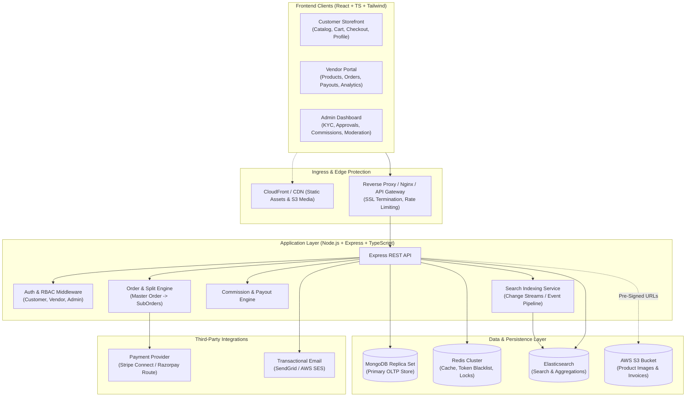
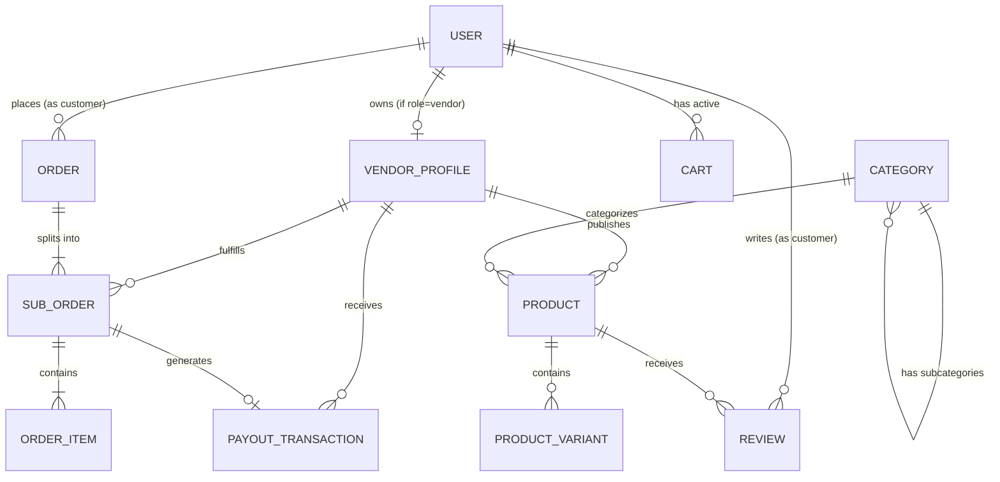
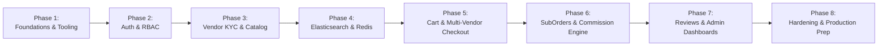
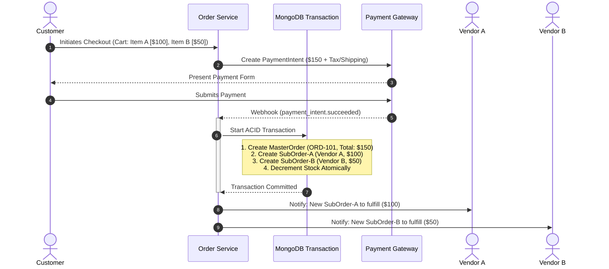

# Production Multi-Vendor E-Commerce Marketplace
## Comprehensive Architectural Blueprint & Technical Specification (Task 1)

---

### Executive Overview & Technology Stack
This document establishes the production-grade engineering foundation for a multi-vendor e-commerce marketplace supporting **Customer**, **Vendor**, and **Admin** personas.

| Layer | Technology | Key Responsibility |
| :--- | :--- | :--- |
| **Frontend** | React 18+ (Vite), TypeScript | Modern reactive SPA with modular dashboards for all three roles |
| **Styling** | Tailwind CSS | Design tokens, responsive layouts, utility-first UI |
| **Backend** | Node.js, Express.js, TypeScript | Layered RESTful API, business logic, transactions, RBAC |
| **Primary Database** | MongoDB + Mongoose | Document storage for catalog, hierarchical orders, reviews |
| **Caching & In-Memory** | Redis | JWT session/blacklist, distributed locks, cart & catalog caching |
| **Search Engine** | Elasticsearch | High-performance full-text search, fuzzy matching, faceted filtering |
| **Media Storage** | AWS S3 + CloudFront | Scalable asset storage with pre-signed upload URLs and CDN delivery |
| **Payment Gateway** | Stripe Connect / Razorpay Route | Split payments, multi-party escrow, automated vendor payouts |

---

## 1. System Architecture Proposal



### Architectural Patterns & Decisions
1. **Layered Monolith with Modular Domain Design**:
   - Rather than jumping prematurely to microservices, we utilize a modular monolithic backend with strict separation of concerns (`Routes` $\rightarrow$ `Controllers` $\rightarrow$ `Services` $\rightarrow$ `Repositories/Models`).
   - Enables high developer velocity, effortless local development, and unified end-to-end type safety, while remaining decoupled enough to extract microservices (e.g., Payment or Search worker) later.
2. **Read/Write Specialization (CQRS-lite)**:
   - **Writes & Critical Reads**: Direct to MongoDB with multi-document ACID transactions for atomic checkouts and inventory mutations.
   - **Search & Filter Reads**: Elasticsearch for full-text search, faceted filters (category, brand, rating, price range), and fuzzy autocomplete.
   - **Hot Reads**: Redis for caching frequently viewed products, user sessions, and cart data.
3. **Eventual Consistency with Change Streams**:
   - Product updates in MongoDB are synchronized to Elasticsearch via MongoDB Change Streams or an application-level event bus, preventing search queries from stressing the primary database.

---

## 2. MongoDB Database Schema & Entity Relationships

### 2.1 Entity Relationship Diagram (ERD)



---

### 2.2 Detailed Mongoose Schemas

#### 1. `User` Schema
```typescript
interface IUser {
  _id: Types.ObjectId;
  name: string;
  email: string;
  passwordHash: string;
  role: 'customer' | 'vendor' | 'admin';
  phone?: string;
  avatarUrl?: string;
  isEmailVerified: boolean;
  status: 'active' | 'suspended' | 'deactivated';
  addresses: Array<{
    _id: Types.ObjectId;
    fullName: string;
    phone: string;
    street: string;
    city: string;
    state: string;
    postalCode: string;
    country: string;
    isDefault: boolean;
  }>;
  createdAt: Date;
  updatedAt: Date;
}
// Indexes: { email: 1 } (unique), { role: 1 }
```

#### 2. `VendorProfile` Schema
```typescript
interface IVendorProfile {
  _id: Types.ObjectId;
  userId: Types.ObjectId; // Ref: User (unique)
  storeName: string;
  slug: string; // unique slug for store URL
  description?: string;
  logoUrl?: string;
  bannerUrl?: string;
  businessDetails: {
    legalEntityName: string;
    taxId: string; // GSTIN / VAT / EIN
    businessAddress: string;
  };
  payoutDetails: {
    provider: 'stripe' | 'razorpay' | 'manual_bank';
    accountId?: string; // Stripe Connect Account ID or Razorpay Fund Account ID
    accountStatus: 'pending' | 'verified' | 'restricted';
  };
  commissionRateOverride?: number; // Nullable; if set, overrides global category rate (e.g. 8%)
  status: 'pending_approval' | 'approved' | 'rejected' | 'suspended';
  metrics: {
    totalSales: number;
    ratingAverage: number;
    ratingCount: number;
  };
  createdAt: Date;
  updatedAt: Date;
}
// Indexes: { userId: 1 } (unique), { slug: 1 } (unique), { status: 1 }
```

#### 3. `Category` Schema
```typescript
interface ICategory {
  _id: Types.ObjectId;
  name: string;
  slug: string; // unique
  description?: string;
  imageUrl?: string;
  parentId?: Types.ObjectId; // Ref: Category (self-referencing for hierarchy)
  ancestors: Array<{ _id: Types.ObjectId; name: string; slug: string }>; // Materialized path for fast ancestor lookups
  commissionRate: number; // Default commission percentage for this category (e.g., 10%)
  isActive: boolean;
  createdAt: Date;
  updatedAt: Date;
}
// Indexes: { slug: 1 } (unique), { parentId: 1 }, { "ancestors._id": 1 }
```

#### 4. `Product` & Variant Schema
```typescript
interface IProductVariant {
  sku: string;
  title: string; // e.g. "Red / XL"
  price: number;
  compareAtPrice?: number;
  stock: number;
  attributes: Array<{ name: string; value: string }>; // e.g. [{ name: "Color", value: "Red" }]
  imageUrl?: string;
}

interface IProduct {
  _id: Types.ObjectId;
  vendorId: Types.ObjectId; // Ref: VendorProfile
  title: string;
  slug: string; // unique
  shortDescription?: string;
  description: string;
  categoryId: Types.ObjectId; // Ref: Category
  brand?: string;
  images: Array<{ url: string; key: string; isPrimary: boolean; altText?: string }>;
  hasVariants: boolean;
  basePrice: number;
  discountPrice?: number;
  totalStock: number;
  variants: IProductVariant[];
  status: 'draft' | 'pending_review' | 'active' | 'out_of_stock' | 'archived';
  specifications: Array<{ key: string; value: string }>;
  ratingAverage: number;
  ratingCount: number;
  isFeatured: boolean;
  createdAt: Date;
  updatedAt: Date;
}
// Indexes: { slug: 1 } (unique), { vendorId: 1, status: 1 }, { categoryId: 1 }, { basePrice: 1 }, { ratingAverage: -1 }
```

#### 5. `Cart` Schema
```typescript
interface ICartItem {
  productId: Types.ObjectId; // Ref: Product
  vendorId: Types.ObjectId; // Ref: VendorProfile
  variantSku?: string;
  quantity: number;
  unitPrice: number; // Cached at time of cart addition
}

interface ICart {
  _id: Types.ObjectId;
  userId?: Types.ObjectId; // Ref: User (nullable for guest carts)
  guestToken?: string; // For anonymous sessions
  items: ICartItem[];
  expiresAt: Date; // TTL index for automatic guest cart cleanup
  updatedAt: Date;
}
// Indexes: { userId: 1 }, { guestToken: 1 }, { expiresAt: 1 } (expireAfterSeconds: 0)
```

#### 6. `MasterOrder` (Parent Order) Schema
```typescript
interface IMasterOrder {
  _id: Types.ObjectId;
  orderNumber: string; // e.g., "ORD-20261103-9182"
  customerId: Types.ObjectId; // Ref: User
  subOrderIds: Types.ObjectId[]; // Ref: SubOrder
  pricing: {
    itemsSubtotal: number;
    shippingTotal: number;
    taxTotal: number;
    discountTotal: number;
    grandTotal: number;
  };
  payment: {
    provider: 'stripe' | 'razorpay';
    transactionId: string;
    paymentIntentId: string;
    status: 'pending' | 'captured' | 'failed' | 'refunded';
    paidAt?: Date;
  };
  shippingAddress: {
    fullName: string;
    phone: string;
    street: string;
    city: string;
    state: string;
    postalCode: string;
    country: string;
  };
  overallStatus: 'placed' | 'processing' | 'partially_fulfilled' | 'completed' | 'cancelled';
  createdAt: Date;
  updatedAt: Date;
}
// Indexes: { orderNumber: 1 } (unique), { customerId: 1 }, { "payment.transactionId": 1 }
```

#### 7. `SubOrder` (Vendor Order) Schema
```typescript
interface ISubOrderItem {
  productId: Types.ObjectId;
  variantSku?: string;
  title: string;
  imageUrl: string;
  quantity: number;
  unitPrice: number;
  subtotal: number;
}

interface ISubOrder {
  _id: Types.ObjectId;
  subOrderNumber: string; // e.g. "ORD-20261103-9182-V01"
  masterOrderId: Types.ObjectId; // Ref: MasterOrder
  vendorId: Types.ObjectId; // Ref: VendorProfile
  customerId: Types.ObjectId; // Ref: User
  items: ISubOrderItem[];
  financialBreakdown: {
    itemsSubtotal: number;
    shippingShare: number;
    taxShare: number;
    commissionRatePercentage: number; // e.g., 10%
    platformCommissionAmount: number; // Calculated commission fee
    vendorNetEarnings: number; // (itemsSubtotal + shippingShare - platformCommissionAmount)
  };
  payoutStatus: 'escrowed' | 'eligible' | 'transferred' | 'refunded_reversal';
  fulfillmentStatus: 'pending' | 'confirmed' | 'shipped' | 'delivered' | 'cancelled' | 'returned';
  shippingTracking?: {
    carrier: string;
    trackingNumber: string;
    trackingUrl?: string;
    dispatchedAt?: Date;
    estimatedDelivery?: Date;
    deliveredAt?: Date;
  };
  createdAt: Date;
  updatedAt: Date;
}
// Indexes: { masterOrderId: 1 }, { vendorId: 1, fulfillmentStatus: 1 }, { customerId: 1 }
```

#### 8. `PayoutTransaction` Schema
```typescript
interface IPayoutTransaction {
  _id: Types.ObjectId;
  vendorId: Types.ObjectId; // Ref: VendorProfile
  subOrderId: Types.ObjectId; // Ref: SubOrder
  amount: number;
  commissionDeducted: number;
  gatewayTransferId: string; // Stripe transfer ID or Razorpay payout ID
  currency: string;
  status: 'scheduled' | 'processing' | 'success' | 'failed';
  failureReason?: string;
  scheduledReleaseDate: Date; // e.g., deliveredAt + 7 days return window
  processedAt?: Date;
  createdAt: Date;
}
// Indexes: { vendorId: 1 }, { subOrderId: 1 }, { scheduledReleaseDate: 1, status: 1 }
```

#### 9. `Review` Schema
```typescript
interface IReview {
  _id: Types.ObjectId;
  productId: Types.ObjectId; // Ref: Product
  subOrderId: Types.ObjectId; // Ref: SubOrder (verifies verified purchase)
  customerId: Types.ObjectId; // Ref: User
  vendorId: Types.ObjectId; // Ref: VendorProfile
  rating: number; // 1 to 5
  title?: string;
  comment: string;
  photos: string[];
  vendorResponse?: {
    text: string;
    respondedAt: Date;
  };
  isVerifiedPurchase: boolean;
  createdAt: Date;
  updatedAt: Date;
}
// Indexes: { productId: 1 }, { customerId: 1, productId: 1 } (unique: 1 review per product per order)
```

---

## 3. API Structure & REST API Naming Conventions

### Standard Response Formats

#### Success Response Envelope (`HTTP 200/201`)
```json
{
  "success": true,
  "message": "Operation completed successfully",
  "data": { ... },
  "meta": {
    "page": 1,
    "limit": 20,
    "total": 142,
    "totalPages": 8
  }
}
```

#### Error Response Envelope (`HTTP 4xx/5xx`)
```json
{
  "success": false,
  "error": {
    "code": "VALIDATION_FAILED",
    "message": "Input validation error",
    "details": [
      { "field": "email", "issue": "Invalid email address format" }
    ]
  }
}
```

### Route Hierarchies & Naming Matrix

| Method | Endpoint | Access Role | Description |
| :--- | :--- | :--- | :--- |
| **Authentication & Profile** | | | |
| `POST` | `/api/v1/auth/register` | Public | Customer & Vendor registration |
| `POST` | `/api/v1/auth/login` | Public | Authenticate user, issue JWT access & refresh tokens |
| `POST` | `/api/v1/auth/refresh` | Public | Rotate refresh token, issue new access token |
| `POST` | `/api/v1/auth/logout` | Authenticated | Invalidate refresh token & blacklist access token |
| `GET` | `/api/v1/users/me` | Authenticated | Get current user profile and role info |
| `PUT` | `/api/v1/users/me/addresses` | Customer | Manage customer shipping/billing addresses |
| **Catalog & Search** | | | |
| `GET` | `/api/v1/categories` | Public | Get hierarchical category tree |
| `GET` | `/api/v1/products` | Public | Browse products with pagination, filters, sorting |
| `GET` | `/api/v1/products/:slug` | Public | Detailed product view |
| `GET` | `/api/v1/search` | Public | Elasticsearch query with full-text, aggregations, fuzziness |
| `GET` | `/api/v1/search/autocomplete` | Public | Instant search suggestions as user types |
| **Cart & Multi-Vendor Checkout** | | | |
| `GET` | `/api/v1/cart` | Public / Customer | Fetch cart items with live stock & price validation |
| `POST` | `/api/v1/cart/items` | Public / Customer | Add item to cart |
| `PATCH` | `/api/v1/cart/items/:itemId` | Public / Customer | Update quantity in cart |
| `DELETE` | `/api/v1/cart/items/:itemId` | Public / Customer | Remove item from cart |
| `POST` | `/api/v1/orders/checkout-session` | Customer | Reserve stock in Redis, create Master + SubOrders, return Payment Intent |
| `GET` | `/api/v1/orders` | Customer | Customer order history (Master Orders) |
| `GET` | `/api/v1/orders/:orderNumber` | Customer | Order details with breakdown across vendors |
| **Vendor Operations** | | | |
| `POST` | `/api/v1/vendor/onboarding` | Vendor | Submit KYC business & bank details |
| `GET` | `/api/v1/vendor/products` | Vendor | List vendor-owned products |
| `POST` | `/api/v1/vendor/products` | Vendor | Create product |
| `PUT` | `/api/v1/vendor/products/:id` | Vendor | Update vendor-owned product |
| `DELETE` | `/api/v1/vendor/products/:id` | Vendor | Soft-delete / archive product |
| `GET` | `/api/v1/vendor/orders` | Vendor | View assigned `SubOrders` only |
| `PATCH` | `/api/v1/vendor/orders/:id/status`| Vendor | Update fulfillment (e.g. ship, add tracking info) |
| `GET` | `/api/v1/vendor/payouts` | Vendor | Payout history, pending escrow balances |
| `GET` | `/api/v1/vendor/analytics` | Vendor | Revenue, best sellers, order volume stats |
| **Admin Controls** | | | |
| `GET` | `/api/v1/admin/vendors` | Admin | Review vendor applications |
| `PATCH` | `/api/v1/admin/vendors/:id/status`| Admin | Approve / Reject / Suspend vendor |
| `PUT` | `/api/v1/admin/commissions` | Admin | Configure platform-wide and category commission rates |
| `GET` | `/api/v1/admin/analytics/overview`| Admin | Platform Gross Merchandise Value (GMV), net revenue |
| `GET` | `/api/v1/admin/orders` | Admin | Super-admin order supervision & dispute intervention |
| **Media & Webhooks** | | | |
| `POST` | `/api/v1/media/presigned-url` | Authenticated | Request AWS S3 direct upload pre-signed URL |
| `POST` | `/api/v1/webhooks/payments` | Public (Signed) | Process gateway events (`payment_intent.succeeded`, etc.) |

---

## 4. Scalable Monorepo Folder Structure

```
multi-vendor-marketplace/
├── package.json                   # Root monorepo workspace configuration
├── tsconfig.base.json             # Shared TypeScript compiler options
├── .editorconfig                  # Formatting standards
├── .gitignore
├── docker-compose.yml             # Local dev services (MongoDB, Redis, Elasticsearch)
├── docs/                          # Architecture & design documentation
│   └── SYSTEM_ARCHITECTURE.md
├── scripts/                       # Seed scripts, index migrations
│   ├── seed-categories.ts
│   └── sync-elasticsearch.ts
│
├── client/                        # React + TypeScript + Vite + Tailwind CSS
│   ├── index.html
│   ├── package.json
│   ├── tsconfig.json
│   ├── vite.config.ts
│   ├── tailwind.config.js
│   ├── postcss.config.js
│   └── src/
│       ├── assets/                # Logos, static imagery, SVG icons
│       ├── components/            # Reusable UI library
│       │   ├── ui/                # Button, Modal, Dropdown, Input, Badge, Table
│       │   ├── layout/            # Navbar, Sidebar, Footer, Breadcrumbs
│       │   ├── common/            # ErrorBoundary, PageLoader, Pagination, EmptyState
│       │   └── forms/             # FormField, ControlledInput, ImageUploader
│       ├── features/              # Domain-driven feature slices
│       │   ├── auth/              # Login, Register, ForgotPassword, AuthGuard
│       │   ├── storefront/        # Landing page, category banners, featured lists
│       │   ├── catalog/           # ProductCard, ProductGrid, FilterSidebar, SearchBar
│       │   ├── product-detail/    # Gallery, VariantPicker, StockBadge, ReviewList
│       │   ├── cart/              # CartDrawer, CartTable, PriceSummary
│       │   ├── checkout/          # ShippingForm, PaymentWidget, OrderConfirmation
│       │   ├── customer-account/  # Profile, Addresses, CustomerOrderHistory
│       │   ├── vendor-dashboard/  # ProductManager, SubOrderManager, PayoutSummary
│       │   └── admin-dashboard/   # VendorKYCList, CommissionConfig, PlatformAnalytics
│       ├── hooks/                 # Custom reusable hooks (useDebounce, useAuth, useCart)
│       ├── services/              # API Client (Axios instances, interceptors, endpoints)
│       ├── store/                 # Zustand global stores (authStore, cartStore)
│       ├── types/                 # Shared frontend DTOs and view models
│       ├── utils/                 # Currency formatters, date helpers, validation schemas
│       ├── routes/                # ProtectedRoute, RoleGuard, router definition
│       ├── App.tsx
│       └── main.tsx
│
└── server/                        # Node.js + Express + TypeScript
    ├── package.json
    ├── tsconfig.json
    ├── .env.example
    └── src/
        ├── config/                # Environment variables, database & external clients
        │   ├── env.config.ts      # Validated process.env (Zod)
        │   ├── db.config.ts       # Mongoose connection with pooling
        │   ├── redis.config.ts    # ioredis client
        │   ├── elastic.config.ts  # Elasticsearch client
        │   ├── s3.config.ts       # AWS S3 client & pre-signer
        │   └── payment.config.ts  # Stripe/Razorpay client
        ├── constants/             # Enums, error codes, HTTP statuses
        ├── controllers/           # HTTP Request/Response handlers
        │   ├── auth.controller.ts
        │   ├── product.controller.ts
        │   ├── search.controller.ts
        │   ├── cart.controller.ts
        │   ├── order.controller.ts
        │   ├── vendor.controller.ts
        │   ├── admin.controller.ts
        │   └── webhook.controller.ts
        ├── middlewares/           # Cross-cutting concerns
        │   ├── auth.middleware.ts       # JWT verification
        │   ├── rbac.middleware.ts       # Role checking: requireRole(['vendor', 'admin'])
        │   ├── validate.middleware.ts   # Zod request validation
        │   ├── error.middleware.ts      # Centralized error handler
        │   ├── rateLimit.middleware.ts  # Redis-backed rate limiting
        │   └── rawBody.middleware.ts    # Webhook signature verification
        ├── models/                # Mongoose Schema & Model definitions
        ├── routes/                # Versioned express routers
        │   ├── v1/
        │   │   ├── auth.routes.ts
        │   │   ├── product.routes.ts
        │   │   ├── search.routes.ts
        │   │   ├── cart.routes.ts
        │   │   ├── order.routes.ts
        │   │   ├── vendor.routes.ts
        │   │   ├── admin.routes.ts
        │   │   └── index.ts
        ├── services/              # Pure business logic layer
        │   ├── auth.service.ts
        │   ├── product.service.ts
        │   ├── search.service.ts        # Elasticsearch indexing & query builder
        │   ├── cart.service.ts
        │   ├── order.service.ts         # Multi-vendor order splitting logic
        │   ├── payout.service.ts        # Commission deduction & payout scheduling
        │   └── s3.service.ts            # Pre-signed upload generation
        ├── validators/            # Zod validation schemas for requests
        ├── types/                 # Express Request overrides, domain interfaces
        ├── utils/                 # AppError, ApiResponse, Logger (Winston), Crypto
        ├── jobs/                  # Background cron/worker jobs (release escrow payouts)
        ├── app.ts                 # Express app initialization & middleware registration
        └── server.ts              # Server startup & graceful shutdown lifecycle
```

---

## 5. Dependency Manifest & Justification

### Backend Dependencies (`server`)

| Package | Purpose & Technical Justification |
| :--- | :--- |
| `express` | Robust, minimalist web framework with mature ecosystem for middleware. |
| `typescript`, `@types/node`, `@types/express` | Strict static typing, preventing null pointer and type-mismatch bugs. |
| `mongoose`, `@types/mongoose` | Schema validation, business modeling, middleware hooks, and transactional queries. |
| `ioredis` | High-performance Redis client with built-in cluster and pipeline support. |
| `@elastic/elasticsearch` | Official client for Elasticsearch indexing, fuzzy searching, and aggregation. |
| `jsonwebtoken`, `@types/jsonwebtoken` | Stateless JWT token issuance and cryptographic verification. |
| `bcryptjs`, `@types/bcryptjs` | Adaptive one-way hashing for secure password storage. |
| `zod` | Declarative schema validation for runtime request validation with TypeScript inference. |
| `cors`, `helmet` | HTTP header security hardening and cross-origin resource sharing policy. |
| `express-rate-limit`, `rate-limit-redis` | Brute-force and DDoS protection at sensitive endpoints. |
| `@aws-sdk/client-s3`, `@aws-sdk/s3-request-presigner`| Direct client-to-S3 uploads, keeping media processing load off the Node.js event loop. |
| `stripe` / `razorpay` | Official SDK for marketplace payouts, customer charges, and webhook events. |
| `cookie-parser` | Parse and sign `httpOnly` authentication cookies. |
| `winston`, `morgan` | Production logging with log levels (error, warn, info) and HTTP access logs. |
| `dotenv` | Environment variable management. |
| `tsx` / `ts-node-dev` (Dev) | Fast TypeScript execution with live reload for developer ergonomics. |

### Frontend Dependencies (`client`)

| Package | Purpose & Technical Justification |
| :--- | :--- |
| `react`, `react-dom` | Declarative, component-based user interface framework. |
| `vite` | Ultra-fast build tool and local dev server with Hot Module Replacement (HMR). |
| `typescript` | End-to-end type safety matching backend API contracts. |
| `react-router-dom` (v6/v7) | Client-side routing, nested routes, and route-level authorization guards. |
| `tailwindcss`, `postcss`, `autoprefixer` | Utility-first CSS framework for performant styling. |
| `lucide-react` | Lightweight, consistent SVG icon set. |
| `@tanstack/react-query` | Server-state management: automatic caching, background refetching, pagination. |
| `zustand` | Lightweight client-state management for cart, auth state, and UI modals. |
| `axios` | HTTP client with request/response interceptors for automatic JWT refresh. |
| `react-hook-form`, `@hookform/resolvers` | Performant, un-rendered form state management with Zod integration. |
| `sonner` | Toast notification system for user action feedback. |
| `recharts` | Composable charting library for Vendor and Admin revenue dashboards. |

---

## 6. Implementation Roadmap



### Detailed Phase Breakdown

* **Phase 1: Foundations & Infrastructure Setup**
  - Initialize monorepo structure, root scripts, and TypeScript configurations.
  - Set up `docker-compose.yml` for local MongoDB, Redis, and Elasticsearch containers.
  - Bootstrap Express boilerplate with unified error handling, environment validation (Zod), and health checks.
  - Initialize React + Vite + Tailwind CSS client with clean folder structure.
* **Phase 2: Authentication, Security & RBAC**
  - Implement User and VendorProfile Mongoose schemas.
  - Build Auth controller/service: Register, Login, Refresh, Logout.
  - Implement JWT cookie strategy with Redis token blacklist.
  - Build frontend Auth state (Zustand), ProtectedRoute, and RoleGuard wrappers.
* **Phase 3: Vendor Onboarding, Categories & Product Catalog**
  - Implement Category hierarchy (with ancestors path) and Admin category management.
  - Vendor store profile creation and KYC submission.
  - AWS S3 pre-signed upload URL service for secure direct image uploads.
  - Vendor Product CRUD with variant handling, SKU generation, and stock management.
* **Phase 4: Advanced Search & Caching Pipeline**
  - Setup Elasticsearch index mapping for products (analyzers, fuzzy matching, filters).
  - Build synchronization mechanism (Mongoose post-save hooks or Change Streams) to keep Elasticsearch up to date.
  - Implement Redis caching for product detail queries and category tree.
  - Build responsive client search bar with debounced autocomplete and faceted filter sidebar.
* **Phase 5: Cart & Multi-Vendor Checkout Flow**
  - Cart service (support both guest tokens in Redis and authenticated persistent carts in MongoDB).
  - Stock validation and distributed hold mechanism in Redis during checkout initiation.
  - Payment gateway integration (Stripe / Razorpay PaymentIntent creation).
  - Webhook listener with signature verification to handle asynchronous payment success.
* **Phase 6: Multi-Vendor Order Splitting & Commission/Payout Engine**
  - Order creation transaction: 1 Master Order $\rightarrow$ $N$ SubOrders (one per vendor).
  - Automated platform commission calculation (Category rate vs Vendor override).
  - Vendor Dashboard: Sub-order listing, status transitions (Pending $\rightarrow$ Shipped $\rightarrow$ Delivered), tracking number entry.
  - Payout ledger and escrow hold period scheduler (releasing funds after dispute/return window).
* **Phase 7: Verified Reviews & Analytics Dashboards**
  - Verified purchase review submission (linked to customer's delivered sub-order item).
  - Automatic recalculation of product and vendor average ratings.
  - Vendor analytics (revenue, order volume, best-performing products).
  - Admin platform analytics (total GMV, platform commission retained, vendor counts).
* **Phase 8: Security Hardening, Testing & Production Readiness**
  - Rate-limiting rules on auth and checkout endpoints.
  - API documentation (Swagger/OpenAPI or Postman collection).
  - Unit and integration tests (Jest/Supertest for API endpoints).
  - Multi-stage production Dockerfiles for client and server.

---

## 7. Security Considerations & Architectural Challenges

### 7.1 Security Considerations
1. **Token Security & CSRF Defense**:
   - Access tokens (15-minute expiry) and Refresh tokens (7-day expiry) stored in `httpOnly`, `Secure`, `SameSite=Strict` cookies to block XSS token theft.
   - Refresh token rotation: Every refresh invalidates the previous refresh token; compromised token reuse invalidates the entire session family in Redis.
2. **Tenant Isolation & Object-Level Authorization**:
   - A vendor must never be able to view, edit, or delete another vendor's products or sub-orders.
   - Enforce database-level tenant filtering: All vendor queries explicitly bind `{ _id: subOrderId, vendorId: req.user.vendorId }`.
3. **Payment Webhook Verification**:
   - Webhook endpoints consume the raw request body to verify cryptographic HMAC signatures before triggering fulfillment logic.
   - Webhook idempotency: Every webhook event ID is recorded in Redis/MongoDB; duplicate events are discarded immediately.
4. **Direct-to-S3 Upload Security**:
   - Rather than streaming large image files through Node.js (which exhausts server RAM and event-loop time), clients request a pre-signed S3 `PUT` URL.
   - The backend validates file extension, MIME type (`image/jpeg`, `image/png`, `image/webp`), and limits file size (e.g., max 5MB).
5. **NoSQL Injection & Input Sanitization**:
   - Enforce Zod schemas on all incoming `req.body`, `req.query`, and `req.params`.
   - Prevent MongoDB query operator injection (e.g. `{"$gt": ""}`).

### 7.2 Architectural Challenges & Mitigations
1. **Dual-Write Consistency (MongoDB vs Elasticsearch)**:
   - *Challenge*: Writing to MongoDB and Elasticsearch sequentially can lead to data drift if Elasticsearch fails mid-operation.
   - *Mitigation*: We implement an event-driven sync service using MongoDB Change Streams (or an outbox collection). If Elasticsearch is temporarily unavailable, failed sync events are retried with exponential backoff.
2. **High-Concurrency Inventory Overselling**:
   - *Challenge*: Two customers buying the last unit of a popular product at the exact same second.
   - *Mitigation*: Atomic conditional updates in MongoDB:
     ```typescript
     await Product.updateOne(
       { _id: productId, "variants.sku": sku, "variants.stock": { $gte: quantity } },
       { $inc: { "variants.$.stock": -quantity, totalStock: -quantity } }
     );
     ```
     If the query modifies 0 documents, the stock is exhausted, and the transaction safely rolls back.
3. **Partial Order Fulfillment and Cancellations**:
   - *Challenge*: Customer buys from Vendor A and Vendor B. Vendor A ships the product, but Vendor B cancels due to stock unavailability.
   - *Mitigation*: The sub-order architecture decouples statuses. Vendor B's sub-order is marked `cancelled`, triggering a partial refund for Vendor B's items without cancelling or disrupting Vendor A's shipment.

---

## 8. Multi-Vendor Orders & Commission Workflow

### 8.1 The Master-to-SubOrder Splitting Mechanics
When a customer checks out a shopping cart containing products from multiple distinct vendors:



---

### 8.2 Commission Calculation Hierarchy
The platform retains a transaction fee based on a tiered priority system:

$$\text{Effective Commission \%} = \begin{cases} 
\text{Vendor Custom Override}, & \text{if explicitly defined by Admin} \\
\text{Category Commission Rate}, & \text{if defined on Product Category} \\
\text{Global Platform Commission}, & \text{fallback (e.g., 10\%)} 
\end{cases}$$

#### Financial Calculation Example
Suppose a customer purchases:
- **Product 1** from Vendor A: Price = **\$100**, Shipping = **\$10**
- Commission rate for Vendor A = **10%**

$$\begin{aligned}
\text{Items Subtotal} &= \$100 \\
\text{Platform Commission} &= \$100 \times 10\% = \$10 \\
\text{Vendor Net Payout} &= (\text{Subtotal} + \text{Shipping}) - \text{Commission} \\
&= (\$100 + \$10) - \$10 = \$100
\end{aligned}$$

The **\$10** platform commission remains in the marketplace platform account, while the **\$100** net balance is allocated to Vendor A's escrow balance.

---

### 8.3 Payout Settlement & Escrow Lifecycle
To protect customers against fraudulent vendors and non-delivery:
1. **Escrow Hold Period**: Net vendor earnings remain in `payoutStatus: 'escrowed'` when an order is placed.
2. **Delivery Confirmation**: Vendor ships the item, adds a carrier tracking code, and marks the sub-order `shipped` $\rightarrow$ `delivered`.
3. **Maturity Window**: After delivery, an escrow maturity timer begins (e.g., **7 days** to account for customer returns or defect disputes).
4. **Automated Transfer**:
   - Once matured without disputes, the scheduled payout job triggers a Stripe Transfer (`stripe.transfers.create`) or Razorpay Linked Account Payout directly to the vendor's connected bank account.
   - Status transitions to `payoutStatus: 'transferred'` with an immutable ledger entry.
