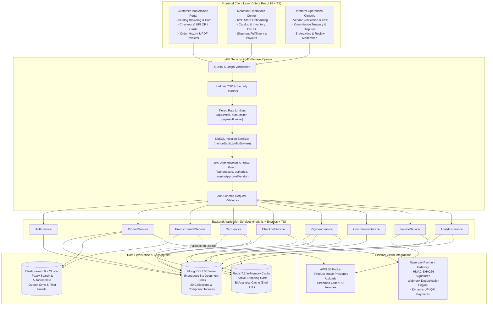
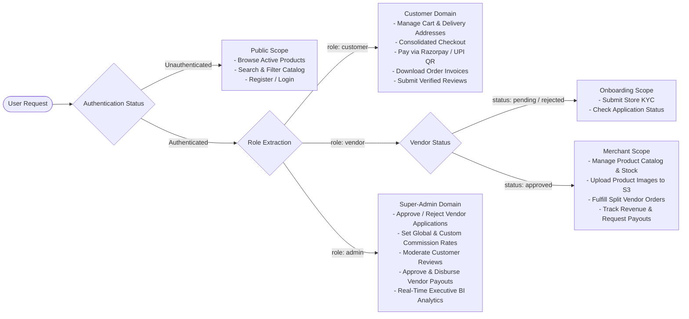
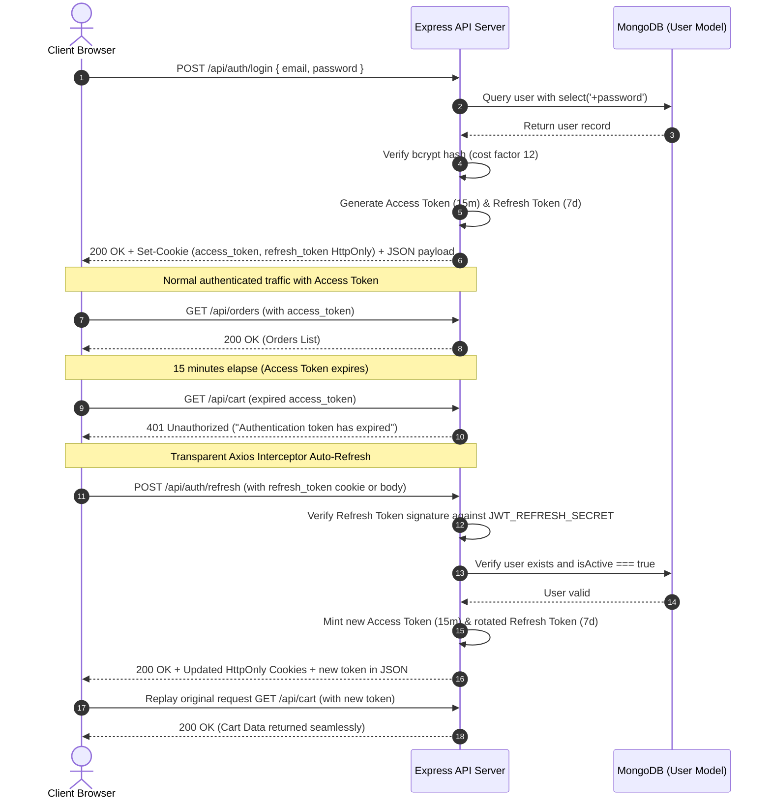
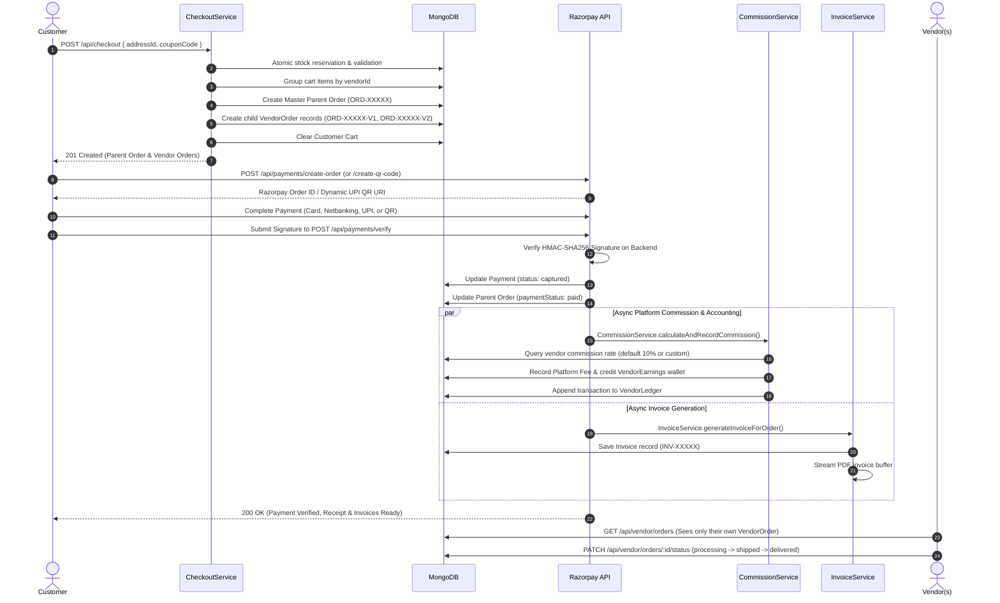
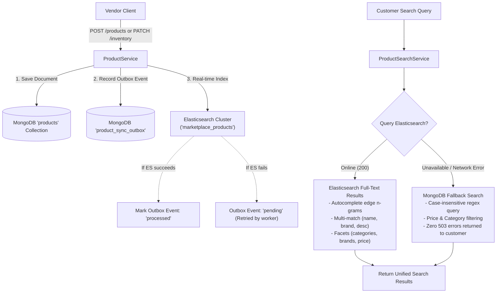
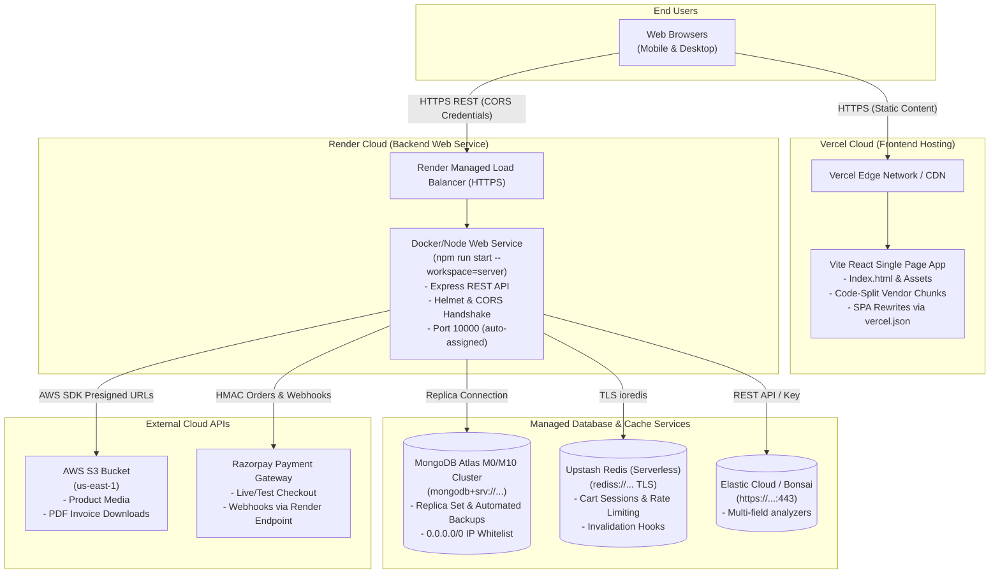

# NexusMarket — System Architecture Diagrams

**Project**: NexusMarket Multi-Vendor E-Commerce Marketplace  
**Document**: Architecture Diagrams & Visual Workflows  
**Target Evaluation**: Engineering Internship & Architecture Review  

---

## 1. High-Level Platform Architecture

The diagram below illustrates the end-to-end platform design: the single-page client application communicating through a hardened API gateway layer to domain services, with dedicated persistence, caching, search, file storage, and payment providers.

---

## 2. Portal & Role-Based Access Control (RBAC) Architecture

NexusMarket implements strict role-based separation and resource ownership verification across three operational domains:

---

## 3. Dual-Token Authentication & Refresh Lifecycle

To deliver seamless session continuity without compromising security, NexusMarket utilizes a dual-token JWT architecture:

---

## 4. Multi-Vendor Order Splitting & Payment Flow

When a customer purchases items from multiple distinct merchants in a single shopping cart, the system enforces transactional order splitting:

---

## 5. Resilient Search & Elasticsearch Outbox Synchronization

Product updates maintain database consistency through an outbox pattern with automatic MongoDB fallback in case of Elasticsearch cluster disruptions:

---

## 6. Cloud Deployment Topology

The diagram below reflects the production cloud deployment configuration established in Phase 12A:

