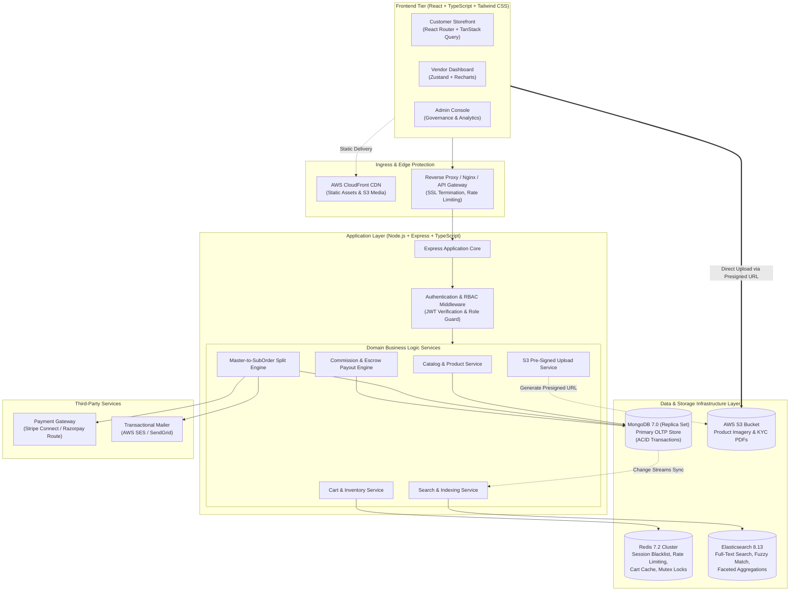
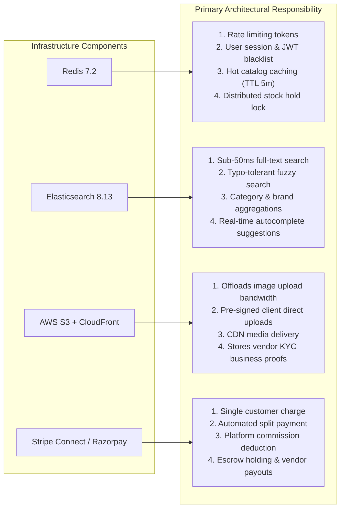
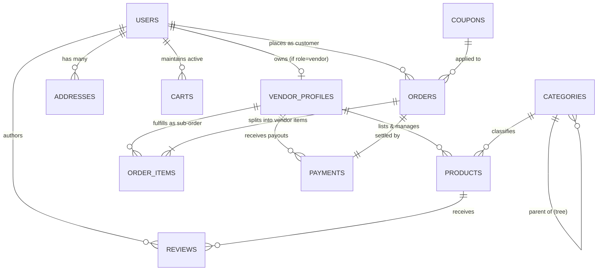
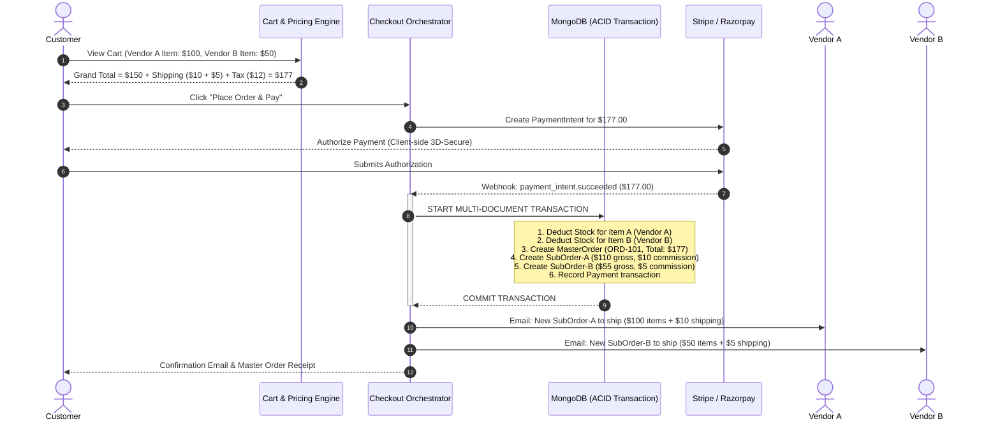
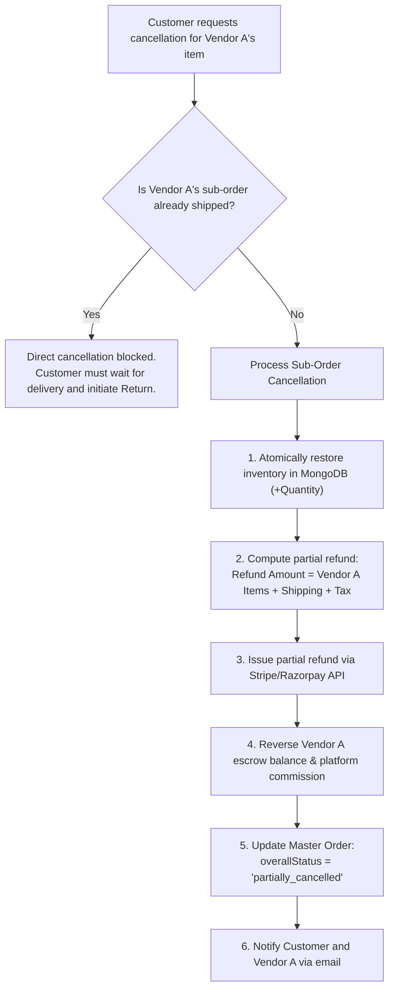

# Multi-Vendor E-Commerce Marketplace
## Comprehensive System Design and Architecture Specification (Phase 1A)

---

## 1. Requirements Analysis

### 1.1 Project Overview
The objective is to build an enterprise-grade, Amazon-style multi-vendor e-commerce marketplace. The platform enables independent third-party **Vendors** to register, undergo administrative KYC verification, showcase and manage product catalogs, and fulfill orders. **Customers** can browse a unified catalog, execute faceted searches across multiple stores, add items from multiple vendors into a single cart, and complete purchases via a single consolidated payment. The **Platform Administrator** oversees marketplace governance, sets commission policies, resolves disputes, and monitors overall Gross Merchandise Value (GMV).

---

### 1.2 Functional Requirements

#### A. Customer Module
- **Account & Security**: User registration, email verification, multi-factor authentication capability, JWT session login, and password reset.
- **Address Book**: Manage multiple shipping and billing addresses with default address designation.
- **Product Discovery**:
  - Browse hierarchical categories with breadcrumb navigation.
  - High-speed full-text search with typo tolerance and autocomplete.
  - Multi-attribute filtering (brand, category, price range, customer rating, in-stock status).
  - Detailed product pages with variant selectors (color, size, SKU), high-resolution image galleries, and pricing comparison.
- **Shopping Cart**:
  - Add products from multiple different vendors into a unified cart.
  - Update quantities, view real-time price totals and shipping estimates.
  - Real-time stock reservation and price staleness check.
- **Checkout & Payment**:
  - Single checkout experience for mixed-vendor carts.
  - Integration with modern payment gateways (Stripe Connect / Razorpay Route).
  - Coupon and discount redemption.
- **Order Tracking & Management**:
  - Consolidated master order view showing itemized breakdown per vendor.
  - Real-time tracking status per shipment (Pending, Dispatched, In-Transit, Delivered).
  - Ability to request item-level or vendor-level cancellation and return.
- **Social Proof & Reviews**:
  - Submit verified buyer ratings (1–5 stars), detailed textual feedback, and image uploads.
  - Upvote helpful reviews and view vendor responses.

#### B. Vendor Module
- **Onboarding & KYC**:
  - Dedicated vendor registration flow.
  - Submission of legal business information (GSTIN/Tax ID, business registration certificate, registered business address).
  - Bank account linking for automated payouts (Stripe Connect Express / Razorpay Fund Account).
- **Storefront Management**:
  - Custom store profile setup (brand logo, banner, bio, customer service contact).
  - Public store URL slug (e.g., `/stores/tech-direct`).
- **Product Catalog Management**:
  - Create, update, duplicate, and archive products.
  - Variant matrix builder (generate combinations of size, color, material with unique SKUs and stock).
  - Direct image uploads to AWS S3 using secure pre-signed URLs.
  - Inventory tracking with low-stock alerts.
- **Order Fulfillment**:
  - Vendor-specific order dashboard displaying only sub-orders assigned to that vendor.
  - Transition order statuses (`Confirmed` $\rightarrow$ `Packed` $\rightarrow$ `Shipped` $\rightarrow$ `Delivered`).
  - Add courier name, tracking number, and tracking URL.
  - Generate printable packing slips and tax invoices.
- **Financial Ledger & Payouts**:
  - Real-time overview of gross sales, platform commissions withheld, and net earnings.
  - Escrow status tracker (funds held during return window vs funds available for withdrawal).
  - Payout transaction history with payout slips.
- **Store Analytics**:
  - Revenue trends, top-selling items, return rates, and customer satisfaction ratings.

#### C. Administrator Module
- **Platform Governance**:
  - Vendor onboarding approval queue (inspect KYC docs, approve, reject, or request revisions).
  - Vendor suspension and store delisting controls.
- **Category & Taxonomy Management**:
  - Infinite-depth hierarchical category tree (Parent Categories $\rightarrow$ Sub-Categories $\rightarrow$ Leaf Categories).
  - Category-specific attribute templates (e.g., Clothing requires "Size" and "Color"; Laptops require "RAM" and "CPU").
- **Commission Policy Engine**:
  - Default global platform commission rate (e.g., 10%).
  - Category-specific commission overrides (e.g., Electronics at 8%, Jewelry at 15%).
  - Vendor-tier commission overrides (e.g., VIP Vendor negotiated rate at 6%).
- **Financial & Escrow Oversight**:
  - Master marketplace financial ledger.
  - Platform net fee earnings vs vendor payout obligations.
  - Manual hold or release overrides on contested payouts.
- **Dispute Resolution & Moderation**:
  - Customer-vendor dispute mediation console.
  - Force partial or full refunds.
  - Content moderation for product listings and user reviews.
- **Executive Analytics**:
  - Platform GMV, total transactions, active customer count, active vendor count, and sales velocity charts.

---

### 1.3 Non-Functional Requirements

| Metric | Target / Specification | Technical Strategy |
| :--- | :--- | :--- |
| **Performance (Latency)** | API responses $< 150\text{ ms}$; Search queries $< 50\text{ ms}$; P99 $< 300\text{ ms}$ | Redis caching for hot reads; Elasticsearch indexing for catalog searches; MongoDB lean queries with compound indexing. |
| **Scalability** | Horizontal scalability supporting $10,000+$ concurrent users and $1,000,000+$ product SKUs | Stateless Express application tier; read replicas for MongoDB; distributed Redis caching; Elasticsearch cluster. |
| **High Availability** | 99.9% uptime | Multi-container Docker deployment; health checks with auto-restart; managed replica sets for MongoDB and Redis. |
| **Data Integrity & Consistency** | Zero overselling; ACID compliance for order processing and financial ledger entries | MongoDB multi-document ACID transactions during checkout; Redis distributed locks for stock deduction. |
| **Security & Compliance** | OWASP Top 10 compliance, PCI-DSS compliance (via payment gateway tokenization), GDPR readiness | `httpOnly` secure cookies; bcrypt password hashing; Zod input validation; Helmet security headers; signed S3 URLs. |
| **Maintainability** | Clean separation of concerns; strict type safety; modular code | TypeScript across frontend and backend; Controller-Service-Repository pattern; automated linting and formatting. |

---

## 2. Role and Permission Design

### 2.1 Role Definitions
The platform recognizes four distinct user identities:
1. **Guest**: Unauthenticated visitor browsing the marketplace.
2. **Customer**: Authenticated buyer purchasing goods and managing personal orders.
3. **Vendor**: Verified merchant managing products, inventory, and assigned sub-orders.
4. **Admin**: Platform operator with unrestricted governance and financial supervision.

---

### 2.2 Permissions Matrix

| Entity / Resource | Guest | Customer | Vendor | Admin |
| :--- | :---: | :---: | :---: | :---: |
| **Public Catalog (Active Products)** | Read | Read | Read | Read |
| **Draft / Pending Products** | No Access | No Access | Read/Write (Own only) | Read/Write/Moderate (All) |
| **Cart Operations** | Session-based | Read/Write (Own) | Read/Write (Own) | No Access |
| **Master Orders** | No Access | Read (Own) | No Access | Read/Manage (All) |
| **Vendor Sub-Orders** | No Access | Read (Own parent) | Read/Fulfill (Own only) | Read/Override (All) |
| **Vendor KYC / Profile** | Read (Public store) | Read (Public store) | Read/Write (Own store) | Read/Approve/Reject (All) |
| **Product Reviews** | Read | Create (Verified items) | Reply (Own products) | Delete/Moderate (All) |
| **Commission Rules** | No Access | No Access | Read (Applicable rate) | Create/Update/Delete (All) |
| **Payout Ledger** | No Access | No Access | Read (Own earnings) | Read/Execute/Hold (All) |
| **Category Hierarchy** | Read | Read | Read | Create/Update/Delete |

---

### 2.3 Role-Based Authorization & Tenant Isolation Architecture

#### How RBAC Works in the Backend
1. **Token Verification (`auth.middleware.ts`)**:
   - The client transmits the JWT access token inside a secure, `httpOnly` cookie with every request.
   - The authentication middleware cryptographically verifies the token signature and extracts `userId`, `role`, and optional `vendorId`.
2. **Role Gatekeeper (`rbac.middleware.ts`)**:
   - Routes declare acceptable roles via a declarative wrapper: `requireRole(['vendor', 'admin'])`.
   - If `req.user.role` does not match, the request immediately terminates with `HTTP 403 Forbidden`.
3. **Object-Level Tenant Isolation**:
   - Checking the role alone is insufficient. A vendor must **never** access another vendor's products or sub-orders.
   - All vendor service queries enforce an ownership filter:
     ```typescript
     // Crucial tenant isolation query constraint:
     const subOrder = await SubOrder.findOne({
       _id: subOrderId,
       vendorId: req.user.vendorId // Enforces strict tenant ownership
     });
     if (!subOrder) {
       throw AppError.notFound('Sub-order not found or unauthorized');
     }
     ```

#### Restricted Operations Summary
- **Customer Restrictions**: Cannot access vendor management portals, cannot view wholesale prices, cannot view other customers' orders or addresses, cannot create products.
- **Vendor Restrictions**: Cannot alter platform commission rates, cannot view customer credit card details, cannot view other vendors' sales/payouts, cannot bypass administrative product review (if moderation is active).
- **Admin Restrictions**: Cannot view raw customer passwords (one-way hashed) or raw payment card details (handled via Stripe/Razorpay elements).

---

## 3. System Architecture

### 3.1 End-to-End System Architecture Diagram



---

### 3.2 Component Communication Details

#### 1. React Frontend to Express Backend
- Communication occurs strictly over HTTPS using a RESTful JSON protocol.
- **Axios HTTP Client**: Uses centralized request/response interceptors.
- **Authentication**: JWT access tokens are transported in `httpOnly`, `SameSite=Strict`, `Secure` cookies, eliminating vulnerabilities to Cross-Site Scripting (XSS).
- **Server State**: Managed via **TanStack React Query**, providing client-side caching, background synchronization, and automatic retry mechanics.
- **Client State**: Lightweight global UI state (sidebar toggles, active role view, temporary cart drawer) is managed with **Zustand**.

#### 2. Express Backend to MongoDB
- Managed using **Mongoose ODM** with connection pooling (default pool size: 10–50 connections).
- **Transactional Consistency**: Multi-document ACID transactions (`session.startTransaction()`) are utilized for critical workflows such as stock reservation and order placement.
- **Index Optimization**: Lean queries (`.lean()`) are used for read-only endpoints to bypass Mongoose hydration overhead and maximize throughput.

#### 3. How Supplementary Technologies Fit into the Architecture



---

## 4. Database Design (MongoDB Schemas)

### 4.1 Entity Relationship Diagram (ERD)



---

### 4.2 Comprehensive Schema Definitions

#### 1. `Users` Collection
Stores authentication credentials, profile data, and system roles.

| Field Name | Type | Constraints / Rules | Description |
| :--- | :--- | :--- | :--- |
| `_id` | `ObjectId` | Primary Key, Auto-generated | Unique user identifier |
| `firstName` | `String` | Required, Trim, Max: 50 | User's given name |
| `lastName` | `String` | Required, Trim, Max: 50 | User's family name |
| `email` | `String` | Required, Unique, Lowercase, Valid Email | Account login email |
| `passwordHash` | `String` | Required, Min: 60 | Bcrypt hashed password string |
| `role` | `String` | Required, Enum: `['customer', 'vendor', 'admin']`, Default: `'customer'` | Authorization access level |
| `phoneNumber` | `String` | Optional, E.164 phone format | Mobile number for SMS updates |
| `avatarUrl` | `String` | Optional, Valid URL | Profile picture link |
| `isEmailVerified` | `Boolean`| Default: `false` | Email verification flag |
| `status` | `String` | Enum: `['active', 'suspended', 'deactivated']`, Default: `'active'` | Account governance status |
| `createdAt` | `Date` | Auto-generated timestamp | Record creation date |
| `updatedAt` | `Date` | Auto-generated timestamp | Record last update date |

- **Indexes**:
  - `{ email: 1 }` (Unique)
  - `{ role: 1 }`
  - `{ status: 1 }`

---

#### 2. `VendorProfiles` Collection
Maintains business credentials, store branding, and payout configuration for sellers.

| Field Name | Type | Constraints / Rules | Description |
| :--- | :--- | :--- | :--- |
| `_id` | `ObjectId` | Primary Key, Auto-generated | Unique vendor profile ID |
| `userId` | `ObjectId` | Required, Unique, Ref: `Users` | Link to primary User account |
| `storeName` | `String` | Required, Trim, Unique, Max: 100 | Public display name of store |
| `slug` | `String` | Required, Unique, Lowercase, Slug format | Storefront URL path parameter |
| `description` | `String` | Optional, Max: 1000 | Store biography / summary |
| `logoUrl` | `String` | Optional, Valid URL | Store avatar / brand logo |
| `bannerUrl` | `String` | Optional, Valid URL | Storefront header banner |
| `businessRegistration` | `Object` | Required Subdocument | Legal tax and business info |
| `businessRegistration.companyName` | `String` | Required | Registered corporate entity name |
| `businessRegistration.taxId` | `String` | Required, Trim (GSTIN / EIN / VAT) | Official tax identification number |
| `businessRegistration.documentUrl` | `String` | Required, Valid URL (S3 private) | Proof of registration document |
| `payoutSettings` | `Object` | Required Subdocument | Merchant payout gateway details |
| `payoutSettings.provider` | `String` | Enum: `['stripe_connect', 'razorpay_route']` | Connected payment rail |
| `payoutSettings.accountId` | `String` | Optional | External merchant account ID |
| `payoutSettings.isPayoutReady` | `Boolean`| Default: `false` | True when payout rails are verified |
| `commissionRateOverride` | `Number` | Optional, Min: 0, Max: 100 | Custom platform fee % (null = use category) |
| `approvalStatus` | `String` | Enum: `['pending', 'approved', 'rejected', 'suspended']`, Default: `'pending'` | Admin KYC approval status |
| `rejectionReason` | `String` | Optional | Administrative feedback if rejected |
| `metrics` | `Object` | Subdocument | Aggregated seller performance |
| `metrics.ratingAverage` | `Number` | Default: 0, Min: 0, Max: 5 | Store average customer rating |
| `metrics.ratingCount` | `Number` | Default: 0 | Total reviews received |
| `metrics.totalSalesCount` | `Number` | Default: 0 | Total items sold |
| `createdAt` | `Date` | Timestamp | Record creation date |
| `updatedAt` | `Date` | Timestamp | Record last update date |

- **Indexes**:
  - `{ userId: 1 }` (Unique)
  - `{ slug: 1 }` (Unique)
  - `{ approvalStatus: 1 }`
  - `{ "metrics.ratingAverage": -1 }`

---

#### 3. `Categories` Collection
Hierarchical taxonomy for organizing products across infinite nesting levels.

| Field Name | Type | Constraints / Rules | Description |
| :--- | :--- | :--- | :--- |
| `_id` | `ObjectId` | Primary Key, Auto-generated | Category identifier |
| `name` | `String` | Required, Trim, Max: 80 | Display name (e.g., "Smartphones") |
| `slug` | `String` | Required, Unique, Lowercase | URL path slug |
| `description` | `String` | Optional, Max: 300 | Category summary |
| `imageUrl` | `String` | Optional, Valid URL | Category icon / promotional image |
| `parentId` | `ObjectId` | Optional, Nullable, Ref: `Categories` | Parent category reference (null for roots) |
| `ancestors` | `Array` | Subdocument array: `[{ _id, name, slug }]` | Materialized path of parent hierarchy |
| `commissionRate` | `Number` | Required, Min: 0, Max: 100, Default: 10 | Category-level commission percentage |
| `isActive` | `Boolean`| Default: `true` | Visibility status |
| `createdAt` | `Date` | Timestamp | Record creation date |
| `updatedAt` | `Date` | Timestamp | Record last update date |

- **Indexes**:
  - `{ slug: 1 }` (Unique)
  - `{ parentId: 1 }`
  - `{ "ancestors._id": 1 }`

---

#### 4. `Products` Collection
The marketplace catalog containing product specifications, pricing, variants, and stock.

| Field Name | Type | Constraints / Rules | Description |
| :--- | :--- | :--- | :--- |
| `_id` | `ObjectId` | Primary Key, Auto-generated | Unique product identifier |
| `vendorId` | `ObjectId` | Required, Ref: `VendorProfiles` | The selling merchant's profile ID |
| `title` | `String` | Required, Trim, Max: 200 | Product listing title |
| `slug` | `String` | Required, Unique, Lowercase | SEO-friendly URL slug |
| `brand` | `String` | Required, Trim, Max: 80 | Manufacturer / Brand name |
| `categoryId` | `ObjectId` | Required, Ref: `Categories` | Leaf category reference |
| `shortDescription` | `String` | Optional, Max: 300 | Quick overview bullet points |
| `description` | `String` | Required | Comprehensive HTML / Markdown description |
| `images` | `Array` | Required, Min: 1 image | Gallery array: `[{ url, key, isPrimary, alt }]` |
| `hasVariants` | `Boolean`| Required, Default: `false` | True if product has SKU variations |
| `basePrice` | `Number` | Required, Min: 0 | Display base price |
| `discountPrice` | `Number` | Optional, Min: 0 | Promotional discounted price |
| `sku` | `String` | Required for non-variant products | Stock Keeping Unit |
| `totalStock` | `Number` | Required, Min: 0, Integer | Available inventory count |
| `variants` | `Array` | Subdocuments: `[VariantSchema]` | Array of SKU combinations |
| `variants.$.sku` | `String` | Required, Unique per product | Variant SKU code |
| `variants.$.title` | `String` | Required (e.g. "Space Gray / 256GB") | Human-readable variant descriptor |
| `variants.$.price` | `Number` | Required, Min: 0 | Variant specific price |
| `variants.$.stock` | `Number` | Required, Min: 0, Integer | Variant inventory level |
| `variants.$.attributes`| `Array` | `[{ name: "Color", value: "Gray" }]` | Key-value attribute definitions |
| `variants.$.imageUrl` | `String` | Optional | Image specific to this variant |
| `status` | `String` | Enum: `['draft', 'pending_approval', 'active', 'out_of_stock', 'archived']` | Lifecycle status |
| `ratingAverage` | `Number` | Default: 0, Min: 0, Max: 5 | Computed average review rating |
| `ratingCount` | `Number` | Default: 0, Integer | Number of reviews |
| `isFeatured` | `Boolean`| Default: `false` | Homepage promotion flag |
| `createdAt` | `Date` | Timestamp | Record creation date |
| `updatedAt` | `Date` | Timestamp | Record last update date |

- **Indexes**:
  - `{ slug: 1 }` (Unique)
  - `{ vendorId: 1, status: 1 }`
  - `{ categoryId: 1, status: 1 }`
  - `{ basePrice: 1 }`
  - `{ ratingAverage: -1 }`
  - `{ createdAt: -1 }`

---

#### 5. `Carts` Collection
Maintains multi-vendor shopping carts for authenticated customers and guest sessions.

| Field Name | Type | Constraints / Rules | Description |
| :--- | :--- | :--- | :--- |
| `_id` | `ObjectId` | Primary Key, Auto-generated | Cart identifier |
| `userId` | `ObjectId` | Optional, Ref: `Users` (Unique when present)| Owner customer ID |
| `guestToken` | `String` | Optional, Unique when present | Anonymous guest session UUID |
| `items` | `Array` | Array of subdocuments | Cart item list |
| `items.$.productId` | `ObjectId` | Required, Ref: `Products` | Product reference |
| `items.$.vendorId` | `ObjectId` | Required, Ref: `VendorProfiles` | Selling vendor reference |
| `items.$.variantSku`| `String` | Optional | Specific variant SKU |
| `items.$.quantity` | `Number` | Required, Min: 1, Integer | Quantity requested |
| `items.$.unitPrice` | `Number` | Required, Min: 0 | Price captured when added |
| `expiresAt` | `Date` | Required | Expiration date for guest carts |
| `updatedAt` | `Date` | Timestamp | Last modified date |

- **Indexes**:
  - `{ userId: 1 }` (Unique, Sparse)
  - `{ guestToken: 1 }` (Unique, Sparse)
  - `{ expiresAt: 1 }` (`expireAfterSeconds: 0` TTL index for automatic Redis-like cleanup)

---

#### 6. `Orders` Collection (Parent / Master Order)
The overarching transaction created when a customer checks out a mixed-vendor cart.

| Field Name | Type | Constraints / Rules | Description |
| :--- | :--- | :--- | :--- |
| `_id` | `ObjectId` | Primary Key, Auto-generated | Master order identifier |
| `orderNumber` | `String` | Required, Unique (e.g. `ORD-20261104-9812`) | Human-readable customer invoice number |
| `customerId` | `ObjectId` | Required, Ref: `Users` | Purchasing customer reference |
| `shippingAddress` | `Object` | Required Embedded Snapshot | Shipping address at time of purchase |
| `billingAddress` | `Object` | Required Embedded Snapshot | Billing address snapshot |
| `pricing` | `Object` | Required Subdocument | Platform-level financial summary |
| `pricing.itemsSubtotal`| `Number`| Required, Min: 0 | Sum of all item prices |
| `pricing.shippingFeeTotal`| `Number`| Required, Min: 0 | Sum of all vendor shipping charges |
| `pricing.taxTotal` | `Number` | Required, Min: 0 | Total sales tax / VAT |
| `pricing.discountTotal`| `Number` | Default: 0, Min: 0 | Coupon discount amount |
| `pricing.grandTotal` | `Number` | Required, Min: 0 | Total charged to customer |
| `couponApplied` | `Object` | Optional Subdocument: `{ couponId, code, discountAmount }` | Details of promotional code used |
| `paymentStatus` | `String` | Enum: `['pending', 'paid', 'failed', 'refunded', 'partially_refunded']` | Overall payment capture state |
| `overallStatus` | `String` | Enum: `['placed', 'processing', 'partially_shipped', 'completed', 'cancelled']` | Composite fulfillment progress |
| `createdAt` | `Date` | Timestamp | Order placement timestamp |
| `updatedAt` | `Date` | Timestamp | Record last update date |

- **Indexes**:
  - `{ orderNumber: 1 }` (Unique)
  - `{ customerId: 1, createdAt: -1 }`
  - `{ paymentStatus: 1 }`

---

#### 7. `OrderItems` Collection (Vendor Sub-Orders / Sub-Order Groups)
Deconstructs the master order into vendor-isolated groups for shipment and accounting.

| Field Name | Type | Constraints / Rules | Description |
| :--- | :--- | :--- | :--- |
| `_id` | `ObjectId` | Primary Key, Auto-generated | Sub-order item identifier |
| `masterOrderId` | `ObjectId` | Required, Ref: `Orders` | Parent master order reference |
| `subOrderNumber`| `String` | Required, Unique (e.g. `ORD-9812-V01`) | Vendor-specific tracking number |
| `vendorId` | `ObjectId` | Required, Ref: `VendorProfiles` | Vendor responsible for fulfillment |
| `customerId` | `ObjectId` | Required, Ref: `Users` | Purchasing customer ID |
| `items` | `Array` | Required, Min: 1 subdocument | Items sold by this specific vendor |
| `items.$.productId`| `ObjectId`| Required, Ref: `Products` | Product purchased |
| `items.$.variantSku`| `String` | Optional | Variant SKU purchased |
| `items.$.title` | `String` | Required | Snapshot of product title |
| `items.$.imageUrl` | `String` | Required | Snapshot of product image |
| `items.$.unitPrice`| `Number` | Required, Min: 0 | Unit price at transaction |
| `items.$.quantity` | `Number` | Required, Min: 1 | Quantity bought |
| `items.$.itemSubtotal`| `Number`| Required | `unitPrice * quantity` |
| `financials` | `Object` | Required Subdocument | Financial ledger for this vendor |
| `financials.vendorSubtotal`| `Number` | Required | Sum of items from this vendor |
| `financials.shippingFee` | `Number` | Required | Shipping allocated to this vendor |
| `financials.commissionRate`| `Number` | Required, Percentage | Rate charged (e.g. 10%) |
| `financials.commissionFee` | `Number` | Required | Platform fee withheld |
| `financials.vendorNetEarnings`| `Number` | Required | Amount owed to vendor |
| `fulfillmentStatus` | `String` | Enum: `['pending', 'confirmed', 'shipped', 'delivered', 'cancelled', 'returned']` | Shipment status |
| `shippingTracking` | `Object` | Optional Subdocument | Carrier details |
| `shippingTracking.carrier` | `String` | Optional (e.g. "FedEx", "BlueDart") | Shipping provider |
| `shippingTracking.trackingCode` | `String` | Optional | Parcel tracking identifier |
| `shippingTracking.trackingUrl` | `String` | Optional | Live tracking URL |
| `shippingTracking.shippedAt` | `Date` | Optional | Dispatch timestamp |
| `shippingTracking.deliveredAt`| `Date` | Optional | Delivery timestamp |
| `payoutStatus` | `String` | Enum: `['escrow_held', 'eligible_for_payout', 'paid_out', 'reversed']` | Payout lifecycle state |
| `createdAt` | `Date` | Timestamp | Sub-order creation date |
| `updatedAt` | `Date` | Timestamp | Record last update date |

- **Indexes**:
  - `{ masterOrderId: 1 }`
  - `{ subOrderNumber: 1 }` (Unique)
  - `{ vendorId: 1, fulfillmentStatus: 1 }`
  - `{ payoutStatus: 1 }`

---

#### 8. `Payments` Collection
Records payment gateway charge intents, transactions, and webhook confirmations.

| Field Name | Type | Constraints / Rules | Description |
| :--- | :--- | :--- | :--- |
| `_id` | `ObjectId` | Primary Key, Auto-generated | Unique payment record ID |
| `masterOrderId` | `ObjectId` | Required, Ref: `Orders` | Related master order |
| `customerId` | `ObjectId` | Required, Ref: `Users` | Payer user reference |
| `gateway` | `String` | Enum: `['stripe', 'razorpay']` | Payment provider used |
| `transactionId`| `String` | Required, Unique | Gateway Charge / Payment ID |
| `paymentIntentId` | `String` | Required | Client secret intent ID |
| `amount` | `Number` | Required, Min: 0 | Total amount captured |
| `currency` | `String` | Required, Default: `'USD'`, Uppercase | ISO 3-letter currency code |
| `status` | `String` | Enum: `['created', 'processing', 'succeeded', 'failed', 'refunded']` | Gateway status |
| `paymentMethod`| `Object` | Subdocument: `{ type: 'card', brand: 'visa', last4: '4242' }` | Sanitized card details |
| `rawWebhookLogs`| `Array` | Subdocument array: `[{ event, receivedAt, payload }]` | Audit trail of webhook calls |
| `createdAt` | `Date` | Timestamp | Record creation timestamp |

- **Indexes**:
  - `{ masterOrderId: 1 }` (Unique)
  - `{ transactionId: 1 }` (Unique)
  - `{ paymentIntentId: 1 }`

---

#### 9. `Reviews` Collection
Customer feedback, star ratings, and seller responses for verified orders.

| Field Name | Type | Constraints / Rules | Description |
| :--- | :--- | :--- | :--- |
| `_id` | `ObjectId` | Primary Key, Auto-generated | Unique review ID |
| `productId` | `ObjectId` | Required, Ref: `Products` | Product reviewed |
| `vendorId` | `ObjectId` | Required, Ref: `VendorProfiles` | Selling vendor |
| `customerId` | `ObjectId` | Required, Ref: `Users` | Reviewer user ID |
| `orderItemId`| `ObjectId` | Required, Ref: `OrderItems` | Verified purchase confirmation |
| `rating` | `Number` | Required, Min: 1, Max: 5, Integer | Star rating |
| `title` | `String` | Optional, Max: 100 | Short headline |
| `comment` | `String` | Required, Min: 10, Max: 2000 | In-depth product review |
| `images` | `Array` | Array of image URLs (Max: 5) | Customer-uploaded photos |
| `isVerifiedPurchase` | `Boolean` | Default: `true` | Verified buyer flag |
| `vendorReply` | `Object` | Optional Subdocument: `{ comment, repliedAt }` | Vendor response |
| `createdAt` | `Date` | Timestamp | Date written |

- **Indexes**:
  - `{ productId: 1, createdAt: -1 }`
  - `{ vendorId: 1 }`
  - `{ customerId: 1, productId: 1 }` (Unique: 1 review per product per customer)

---

#### 10. `Coupons` Collection
Promotional discounts created either platform-wide by Admins or store-wide by Vendors.

| Field Name | Type | Constraints / Rules | Description |
| :--- | :--- | :--- | :--- |
| `_id` | `ObjectId` | Primary Key, Auto-generated | Coupon ID |
| `code` | `String` | Required, Unique, Uppercase, Trim | Promo code entered at checkout (e.g. `SAVE20`) |
| `discountType`| `String` | Enum: `['percentage', 'fixed_amount']` | Calculation method |
| `discountValue`| `Number` | Required, Min: 1 | Percentage off or dollar amount |
| `vendorId` | `ObjectId` | Optional, Nullable, Ref: `VendorProfiles` | Null = Platform Admin coupon; Set = Vendor coupon |
| `minOrderValue`| `Number` | Default: 0, Min: 0 | Minimum cart amount required |
| `maxDiscount`| `Number` | Optional, Min: 0 | Cap for percentage discounts |
| `startDate` | `Date` | Required | Start validity date |
| `endDate` | `Date` | Required | Expiration date |
| `usageLimit` | `Number` | Optional, Integer | Maximum total redemptions allowed |
| `usedCount` | `Number` | Default: 0, Integer | Times redeemed |
| `isActive` | `Boolean` | Default: `true` | Admin/Vendor activation toggle |

- **Indexes**:
  - `{ code: 1 }` (Unique)
  - `{ isActive: 1, startDate: 1, endDate: 1 }`

---

#### 11. `Addresses` Collection
Customer delivery destinations with support for multiple saved addresses.

| Field Name | Type | Constraints / Rules | Description |
| :--- | :--- | :--- | :--- |
| `_id` | `ObjectId` | Primary Key, Auto-generated | Address record ID |
| `userId` | `ObjectId` | Required, Ref: `Users` | Owning customer ID |
| `fullName` | `String` | Required, Max: 80 | Recipient full name |
| `phoneNumber`| `String` | Required, Phone format | Recipient contact number |
| `street` | `String` | Required, Max: 200 | Street address and apartment/suite |
| `city` | `String` | Required, Max: 100 | City name |
| `state` | `String` | Required, Max: 100 | State / Province |
| `postalCode` | `String` | Required, Max: 20 | ZIP / Postal code |
| `country` | `String` | Required, ISO 2-letter country code | Country code (e.g. `US`, `IN`) |
| `isDefault` | `Boolean` | Default: `false` | Primary shipping address indicator |
| `createdAt` | `Date` | Timestamp | Record creation date |

- **Indexes**:
  - `{ userId: 1 }`
  - `{ userId: 1, isDefault: 1 }`

---

## 5. Multi-Vendor Business Logic

### 5.1 The Unified Multi-Vendor Checkout Workflow
A core challenge of an Amazon-style marketplace is enabling a customer to place a single unified order for items belonging to multiple different vendors.



---

### 5.2 Parent Order and Sub-Order Decomposition
1. **Parent Order (`Orders`)**:
   - Represents the complete customer checkout session.
   - Holds the single payment gateway transaction ID.
   - Summarizes aggregate shipping, total taxes, applied coupons, and total amount billed.
2. **Sub-Orders (`OrderItems` / Vendor Orders)**:
   - The master order is instantly decomposed into $N$ sub-orders, where $N$ is the number of distinct vendors present in the cart.
   - Each sub-order has its own independent fulfillment lifecycle. Vendor A shipping their package does **not** depend on or block Vendor B.

---

### 5.3 Commission Calculation Hierarchy
The marketplace retains a platform commission fee on every sale. To offer business flexibility, the commission calculation engine applies the following prioritized rules:

$$\text{Effective Commission \%} = \begin{cases} 
\text{Vendor Custom Override}, & \text{if set in VendorProfile} \\
\text{Category Commission Rate}, & \text{if set in Product's Category} \\
\text{Global Default Rate (10\%)}, & \text{fallback platform default}
\end{cases}$$

#### Step-by-Step Numerical Example
Consider a customer cart with two items:
- **Product 1 (from Vendor A)**:
  - Category: *Electronics* (Category Commission = **8%**)
  - Vendor A has no custom override.
  - Item Price = **\$200.00**, Shipping Fee = **\$15.00**
  - $\text{Commission Amount} = \$200.00 \times 8\% = \mathbf{\$16.00}$
  - $\text{Vendor A Net Earnings} = (\$200.00 + \$15.00) - \$16.00 = \mathbf{\$199.00}$
- **Product 2 (from Vendor B)**:
  - Category: *Fashion Apparel* (Category Commission = **15%**)
  - Vendor B has a VIP negotiated override of **12%** set on their profile.
  - Item Price = **\$100.00**, Shipping Fee = **\$5.00**
  - $\text{Commission Amount} = \$100.00 \times 12\% = \mathbf{\$12.00}$
  - $\text{Vendor B Net Earnings} = (\$100.00 + \$5.00) - \$12.00 = \mathbf{\$93.00}$

**Platform Net Commission Captured**: $\$16.00 + \$12.00 = \mathbf{\$28.00}$.

---

### 5.4 Escrow Lifecycle & Payout Settlement
To protect customers from defective items, non-delivery, or scam vendors, funds are held in escrow:
1. **`escrow_held`**: Upon payment capture, vendor earnings are credited to a virtual pending balance.
2. **Delivery Confirmation**: The vendor ships the goods and enters tracking credentials. The carrier confirms delivery, updating sub-order status to `delivered`.
3. **Maturity Window (Return Period)**: An escrow holding clock begins (e.g., **7 days**). If the customer reports a damaged item or files a dispute, the payout is locked.
4. **Automated Release**: If no dispute is filed within 7 days, a scheduled worker triggers an automated transfer (`stripe.transfers.create` or Razorpay linked account transfer) directly into the vendor's verified bank account, moving status to `paid_out`.

---

### 5.5 Granular Cancellations and Refunds



---

## 6. Security Design

```mermaid
flowchart LR
    Request["Incoming HTTPS Request"] --> Helmet["1. Helmet Headers\n(CSP, HSTS, X-Frame)"]
    Helmet --> CORS["2. CORS Validation\n(Client Origin Whitelist)"]
    CORS --> RateLimiter["3. Redis Rate Limiter\n(100 req/min per IP)"]
    RateLimiter --> BodyParse["4. Body Parser & Sanitizer\n(NoSQL Injection Filter)"]
    BodyParse --> JWT["5. JWT Auth Guard\n(httpOnly Cookie Verification)"]
    JWT --> RBAC["6. RBAC Role Check\n(Customer vs Vendor vs Admin)"]
    RBAC --> Ownership["7. Tenant Ownership Check\n(vendorId matching)"]
    Ownership --> Controller["Controller Execution"]
```



### 6.1 Authentication Architecture
- **Dual-Token System**:
  - **Access Token**: Short-lived (15 minutes), signed with `JWT_ACCESS_SECRET` (HMAC SHA-256), containing `userId` and `role`.
  - **Refresh Token**: Long-lived (7 days), signed with `JWT_REFRESH_SECRET`, stored securely in Redis against the user ID.
- **Cookie Security**: Tokens are transmitted strictly in HTTP headers via `Set-Cookie` with flags:
  - `httpOnly = true`: Inaccessible to JavaScript (prevents XSS credential theft).
  - `Secure = true`: Transmitted only over encrypted HTTPS connections.
  - `SameSite = 'Strict'`: Prevents Cross-Site Request Forgery (CSRF).
- **Token Rotation & Invalidation**:
  - Whenever a refresh token is exchanged, the existing token is discarded, and a new key pair is generated.
  - Logout operations place the token on a Redis revocation blacklist with a TTL matching the token's remaining lifespan.

---

### 6.2 Password Security
- Passwords must meet complexity requirements enforced by Zod: minimum 8 characters, at least one uppercase letter, one number, and one special symbol.
- Hashing is performed using **bcrypt** with a work factor of **12 salt rounds**, incorporating internal salting to defeat rainbow table attacks.
- Passwords are never returned in database query projections (`select('-passwordHash')`).

---

### 6.3 Input Validation & Injection Mitigation
- **Zod Runtime Schema Validation**: Every incoming HTTP request (`body`, `query`, and `params`) is validated against strict Zod schemas before reaching business logic. Unknown or unpermitted properties are stripped immediately.
- **NoSQL Injection Defense**: Express parameters are sanitized to prevent operator injection (e.g., query strings containing `{"$gt": ""}`). Mongoose schema casting guarantees parameters match expected primitive types.
- **XSS Defense**: Output is sanitized. React's JSX automatically escapes dynamic values before DOM insertion.

---

### 6.4 Rate Limiting & DDoS Prevention
- Redis-backed sliding window rate limiters protect the API gateway:
  - **Global API**: Maximum 300 requests per 15-minute window per IP.
  - **Authentication Endpoints (`/login`, `/register`)**: Maximum 10 attempts per 15-minute window per IP to eliminate credential stuffing and brute-force attacks.
  - **Payment & Checkout**: Maximum 10 checkout session creations per hour per user.

---

### 6.5 Secure Payment Verification & Webhook Handling
- **No Client-Side Financial Trust**: Prices sent from frontend clients are completely discarded. The backend recomputes all item subtotals, taxes, shipping, and discounts directly from MongoDB during order creation.
- **Cryptographic Webhook Signatures**: All incoming webhook events from Stripe (`stripe-signature`) or Razorpay (`x-razorpay-signature`) are validated using raw buffer payloads and HMAC-SHA256 signature verification before processing.
- **Idempotency**: Webhook event IDs are tracked in a dedicated Redis/MongoDB set. If a duplicate webhook is delivered, it is recognized and acknowledged (`HTTP 200`) without re-running transactions or doubling stock deductions.

---

## 7. Potential Technical Challenges & Recommended Solutions

| Challenge | Architectural Risk | Recommended Engineering Solution |
| :--- | :--- | :--- |
| **Dual-Write Drift (MongoDB vs Elasticsearch)** | Elasticsearch becomes out of sync with MongoDB if an index operation fails after a product is saved. | Implement MongoDB **Change Streams** with an event-driven sync worker. If Elasticsearch is unreachable, failed operations queue in Redis and retry with exponential backoff. |
| **High-Concurrency Inventory Overselling** | Multiple customers purchasing the final unit of a scarce product simultaneously. | Utilize atomic conditional writes: `Product.updateOne({ _id, stock: { $gte: qty } }, { $inc: { stock: -qty } })`. Combine with a temporary 10-minute Redis reservation key during payment. |
| **Mixed Cart Partial Cancellations** | One vendor cancels out of stock, while another vendor's item is already dispatched. | Decouple fulfillment status to the Sub-Order level. Cancel only the affected vendor's sub-order, issue a partial refund via the payment gateway API, and keep other sub-orders active. |
| **Media Server Bottlenecks** | Vendors uploading large product image files directly to Express exhausting server RAM and bandwidth. | Direct-to-S3 uploads via **Pre-Signed URLs**. Express only generates an authenticated, short-lived S3 upload signature; the client uploads directly to S3. |
| **Search Query Cold Starts & Latency** | Complex faceted filtering across millions of variants slowing down database reads. | Offload all search, autocomplete, and faceted category filtering to an Elasticsearch cluster. Cache common query result IDs in Redis for 5 minutes. |

---

## 8. Development Roadmap (12 Phases with Substeps)

```mermaid
gantt
    title 12-Phase Multi-Vendor Marketplace Implementation
    dateFormat  YYYY-MM-DD
    section Core Infrastructure
    Phase 1: Architecture & Scaffolding    :done, 2026-11-01, 2026-11-04
    Phase 2: Auth & RBAC Security          :active, 2026-11-05, 2026-11-08
    Phase 3: Profiles & Vendor KYC         :2026-11-09, 2026-11-12
    section Catalog & Search
    Phase 4: Hierarchical Categories       :2026-11-13, 2026-11-15
    Phase 5: Product Catalog & S3 Upload   :2026-11-16, 2026-11-20
    Phase 6: Elasticsearch & Discovery     :2026-11-21, 2026-11-24
    section Transactions & Orders
    Phase 7: Cart & Coupon Promotions      :2026-11-25, 2026-11-28
    Phase 8: Multi-Vendor Checkout & Split :2026-11-29, 2026-12-03
    Phase 9: Order Fulfillment & Tracking  :2026-12-04, 2026-12-07
    section Governance & Production
    Phase 10: Financial Ledger & Escrow    :2026-12-08, 2026-12-11
    Phase 11: Verified Reviews & Ratings   :2026-12-12, 2026-12-14
    Phase 12: Admin Analytics & Hardening  :2026-12-15, 2026-12-18
```

### Phase 1: System Design, Architecture & Monorepo Foundation
- **Substep 1A: Architectural Blueprint & API Planning Specification** *(Current Step)*
  - Deliver comprehensive system design documentation, ERD schemas, security policies, and complete REST API contract.
- **Substep 1B: Monorepo Scaffolding & Tooling Verification** *(Completed)*
  - Scaffold root workspaces, Express TypeScript backend, Vite React frontend, Docker services, and baseline health checks.

### Phase 2: Authentication, Security & Role-Based Access Control
- **Substep 2A: Backend Auth Engine & JWT/Redis Middleware**
  - Implement `User` model, bcrypt password hashing, access/refresh token rotation, and Redis token blacklist.
- **Substep 2B: Frontend Auth UI, Stores & Role Guards**
  - Build Login/Register forms with React Hook Form + Zod, Zustand auth store, and protected route wrappers.

### Phase 3: User Profiles & Vendor Onboarding
- **Substep 3A: Customer Address Management & Profile Settings**
  - Multiple shipping/billing addresses CRUD, default address selection, and customer account dashboard.
- **Substep 3B: Vendor KYC Submission & Admin Approval Pipeline**
  - Vendor store profile creation, tax/business document uploads, and Admin verification/approval console.

### Phase 4: Category Hierarchy & Taxonomy Management
- **Substep 4A: Hierarchical Category Model & Admin Management**
  - Infinite-depth category tree schema with materialized ancestor paths, category commissions, and Admin CRUD.
- **Substep 4B: Storefront Category Navigation & Breadcrumbs**
  - Responsive multi-level navigation menu, mobile category drawer, and dynamic breadcrumbs.

### Phase 5: Product Catalog & Media Pipeline
- **Substep 5A: AWS S3 Pre-Signed Upload & Image Processing**
  - Express pre-signed URL generator with MIME/size validation, and client-side direct S3 image uploader.
- **Substep 5B: Vendor Product CRUD, Variants & SKU Management**
  - Product creation wizard, variant matrix generator (color, size, price, stock), and vendor catalog table.

### Phase 6: Search & Discovery Engine
- **Substep 6A: Elasticsearch Index Mapping & MongoDB Sync Pipeline**
  - Elasticsearch cluster configuration, analyzers, index mappings, and MongoDB Change Stream sync worker.
- **Substep 6B: Search UI with Faceted Filters, Autocomplete & Redis Caching**
  - Debounced search bar, typo-tolerant autocomplete, faceted filter sidebar (brand, price, rating), and Redis query caching.

### Phase 7: Shopping Cart & Promotions
- **Substep 7A: Persistent Multi-Vendor Cart with Live Stock Verification**
  - Hybrid guest session & authenticated MongoDB cart, real-time price validation, and stock availability checks.
- **Substep 7B: Coupon Engine with Platform & Vendor-Specific Promo Rules**
  - Discount calculation engine (percentage vs fixed amount, minimum purchase caps) and checkout promo code input.

### Phase 8: Multi-Vendor Checkout & Payment Gateway
- **Substep 8A: Order Splitting Engine (Master Order $\rightarrow$ SubOrders)**
  - Atomic MongoDB transaction decomposing mixed carts into 1 Master Order and $N$ Vendor Sub-Orders.
- **Substep 8B: Payment Gateway Integration & Webhook Reconciliation**
  - Stripe Connect / Razorpay payment intent integration, client payment forms, and cryptographic webhook listener.

### Phase 9: Order Fulfillment & Vendor Order Management
- **Substep 9A: Vendor Sub-Order Dashboard & Tracking Dispatch**
  - Vendor-isolated order view, status transition state machine (`Confirmed` $\rightarrow$ `Shipped` $\rightarrow$ `Delivered`), and courier tracking entry.
- **Substep 9B: Customer Order Tracking & Partial Cancellation Flow**
  - Customer order timeline, itemized shipment tracking, and granular item/sub-order cancellation workflow.

### Phase 10: Financial Ledger, Commission & Payouts
- **Substep 10A: Commission Calculation & Escrow Settlement Engine**
  - Commission deduction engine (Category vs Vendor override), and 7-day post-delivery escrow hold timer.
- **Substep 10B: Automated Vendor Payouts & Payout History**
  - Scheduled payout release worker, Stripe Transfers / Razorpay payouts, and vendor earnings statement.

### Phase 11: Ratings, Reviews & Social Proof
- **Substep 11A: Verified Purchase Review Engine & Photo Uploads**
  - Review submission gated by verified delivery, 1–5 star rating, and customer review photo attachments.
- **Substep 11B: Aggregate Rating Recalculation & Vendor Reply UI**
  - Asynchronous recalculation of product and vendor average scores, and vendor public reply thread.

### Phase 12: Admin Governance, Analytics & Production Hardening
- **Substep 12A: Super-Admin Analytics Dashboard (GMV, Payouts, Trends)**
  - Comprehensive executive metrics (GMV, platform net revenue, active vendors, dispute volume) with Recharts.
- **Substep 12B: Security Audit, Rate Limiting, Docker Production Builds & CI/CD**
  - Final security audit, Redis rate limiters, multi-stage production Dockerfiles, and deployment documentation.

