# NexusMarket — Database Entity-Relationship (ER) Documentation

**Project**: NexusMarket Multi-Vendor E-Commerce Marketplace  
**Document**: Entity-Relationship Model & Cardinality Specification  
**Target Evaluation**: Engineering Internship & Database Architecture Review  

---

## 1. Visual Entity-Relationship Diagram

The diagram below maps all core entities in the NexusMarket MongoDB database, highlighting primary keys (`PK`), foreign keys (`FK`), attributes, and relational cardinalities.

```mermaid
erDiagram
    %% Core Entities & Relationships
    USER ||--o| VENDOR_PROFILE : "onboards as"
    USER ||--o{ ADDRESS : "maintains"
    USER ||--o| CART : "owns"
    USER ||--o{ ORDER : "places"
    USER ||--o{ VENDOR_ORDER : "assigned to fulfill"
    USER ||--o| VENDOR_EARNINGS : "holds wallet balance"
    USER ||--o{ VENDOR_LEDGER : "audited by"
    USER ||--o{ VENDOR_PAYOUT : "requests withdrawals"
    USER ||--o{ REVIEW : "writes"
    USER ||--o{ REVIEW_VOTE : "casts vote"
    USER ||--o{ COUPON_USAGE : "redeems"

    CATEGORY ||--o{ CATEGORY : "hierarchical parent"
    CATEGORY ||--o{ PRODUCT : "classifies"

    PRODUCT }o--|| USER : "owned by merchant"
    PRODUCT ||--o{ REVIEW : "receives ratings"
    PRODUCT ||--o{ PRODUCT_SYNC_OUTBOX : "triggers search sync"

    ORDER ||--|{ VENDOR_ORDER : "partitions into"
    ORDER ||--|| PAYMENT : "settled via"
    ORDER ||--o{ INVOICE : "generates receipts"

    COUPON ||--o{ COUPON_USAGE : "tracks redemption limits"
    REVIEW ||--o{ REVIEW_VOTE : "accumulates helpful votes"

    %% Entity Attribute Definitions
    USER {
        ObjectId _id PK
        string name
        string email UK
        string password
        string role "customer | vendor | admin"
        boolean isActive
        date createdAt
    }

    VENDOR_PROFILE {
        ObjectId _id PK
        ObjectId userId FK
        string storeName
        string slug UK
        string businessEmail
        string businessPhone
        object businessAddress
        string status "pending | approved | rejected"
        number commissionRate
    }

    CATEGORY {
        ObjectId _id PK
        string name UK
        string slug UK
        ObjectId parentId FK
        boolean isActive
    }

    PRODUCT {
        ObjectId _id PK
        string name
        string sku UK
        number price
        number stock
        ObjectId categoryId FK
        ObjectId vendorId FK
        string status "draft | active | inactive"
        boolean isDeleted
        number averageRating
        number reviewCount
    }

    ADDRESS {
        ObjectId _id PK
        ObjectId userId FK
        string fullName
        string phone
        string addressLine1
        string city
        string state
        string postalCode
        string country
        boolean isDefault
    }

    CART {
        ObjectId _id PK
        ObjectId userId FK
        array items "productId, quantity"
        date updatedAt
    }

    ORDER {
        ObjectId _id PK
        string orderNumber UK
        ObjectId userId FK
        object deliveryAddress "immutable snapshot"
        array items "consolidated snapshot"
        number subtotal
        number shippingAmount
        number discountAmount
        number totalAmount
        string paymentMethod
        string paymentStatus "pending | paid | failed"
        string orderStatus "confirmed | processing | shipped | delivered"
    }

    VENDOR_ORDER {
        ObjectId _id PK
        string vendorOrderNumber UK
        ObjectId parentOrderId FK
        ObjectId vendorId FK
        array items "vendor items snapshot"
        number vendorSubtotal
        number vendorTotal
        string orderStatus "confirmed | processing | shipped | delivered"
        object shipmentTracking "carrier, trackingNumber"
        array statusHistory
    }

    PAYMENT {
        ObjectId _id PK
        ObjectId customerId FK
        ObjectId parentOrderId FK
        string razorpayOrderId UK
        string razorpayPaymentId UK
        string razorpaySignature
        string razorpayQrId UK
        string status "pending | captured | failed"
        number amount
        string currency
        date verifiedAt
    }

    VENDOR_EARNINGS {
        ObjectId _id PK
        ObjectId vendorId FK, UK
        number totalGrossSales
        number totalCommission
        number availableBalance
        number pendingBalance
        number paidOutAmount
    }

    VENDOR_LEDGER {
        ObjectId _id PK
        ObjectId vendorId FK
        string eventType "order_credited | commission_deducted | payout_settled"
        string referenceId
        number amount
        number balanceAfter
        date createdAt
    }

    VENDOR_PAYOUT {
        ObjectId _id PK
        string payoutNumber UK
        ObjectId vendorId FK
        number amount
        string status "pending | approved | paid | rejected"
        string payoutMethod "bank_transfer | upi"
        object payoutDetails
    }

    REVIEW {
        ObjectId _id PK
        ObjectId productId FK
        ObjectId userId FK
        number rating "1-5"
        string title
        string comment
        boolean isVerifiedPurchase
        number helpfulVotes
        string status "approved | rejected"
    }

    REVIEW_VOTE {
        ObjectId _id PK
        ObjectId reviewId FK
        ObjectId userId FK
        string voteType "helpful | unhelpful"
    }

    COUPON {
        ObjectId _id PK
        string code UK
        string discountType "percentage | fixed"
        number discountValue
        number minimumOrderAmount
        date expiryDate
        number perUserUsageLimit
        boolean isActive
    }

    COUPON_USAGE {
        ObjectId _id PK
        ObjectId couponId FK
        ObjectId userId FK
        ObjectId orderId FK
        number discountApplied
        date usedAt
    }

    INVOICE {
        ObjectId _id PK
        string invoiceNumber UK
        ObjectId parentOrderId FK
        ObjectId customerId FK
        ObjectId vendorId FK
        string invoiceType "customer_parent | vendor_order"
        number totalAmount
        string pdfFileKey
        date createdAt
    }

    PRODUCT_SYNC_OUTBOX {
        ObjectId _id PK
        ObjectId productId FK
        string action "index | delete"
        string status "pending | processed | failed"
        date createdAt
    }
```

---

## 2. Cardinality Analysis & Relational Invariants

### 2.1 Multi-Vendor Order Partitioning
$$\text{ORDER } (1) \longleftrightarrow (N) \text{ VENDOR\_ORDER}$$
- A customer transaction creates exactly **1 Master Parent Order** (`Order`).
- The system groups purchased items by `vendorId`. For $k$ distinct merchants with items in the cart, exactly $k$ **VendorOrder** documents are created.
- **Relational Invariant**:
  $$\text{Order.subtotal} \equiv \sum_{i=1}^k \text{VendorOrder}_i\text{.vendorSubtotal}$$
- Changes made by Vendor $A$ to their shipment status (`shipped`, `delivered`) update only $\text{VendorOrder}_A$. The master `Order.orderStatus` updates to composite intermediate states (`partially_shipped`, `partially_delivered`) until all child orders reach final state.

### 2.2 Payment & Escrow Commission Settlement
$$\text{ORDER } (1) \longleftrightarrow (1) \text{ PAYMENT}$$
$$\text{VENDOR\_ORDER } (1) \longleftrightarrow (1) \text{ VENDOR\_EARNINGS UPDATE}$$
$$\text{VENDOR\_EARNINGS } (1) \longleftrightarrow (N) \text{ VENDOR\_LEDGER}$$
- Upon verified capture of the `Payment` record via HMAC signature or webhook:
  1. The master `Order.paymentStatus` is flagged `paid`.
  2. For each participating vendor, the platform applies the merchant's commission rate (e.g., 10%):
     $$\text{Fee} = \text{VendorOrder.subtotal} \times \text{CommissionRate}$$
     $$\text{Net Credit} = \text{VendorOrder.subtotal} - \text{Fee}$$
  3. The merchant's `VendorEarnings.availableBalance` is credited by $\text{Net Credit}$.
  4. Two immutable entries are appended to `VendorLedger`: one for the gross order credit and one for the platform commission debit.

### 2.3 Verified Review Audit Trail
$$\text{USER } (1) \longleftrightarrow (N) \text{ REVIEW}$$
$$\text{PRODUCT } (1) \longleftrightarrow (N) \text{ REVIEW}$$
- A customer can write reviews for products.
- Before accepting a review, the backend executes an ownership verification check: it queries whether the user owns a `delivered` order containing that `productId`. If confirmed, the review is created with `isVerifiedPurchase: true`.
- An index compound key `{ productId: 1, userId: 1 }` prevents a customer from submitting duplicate reviews for the same product.

### 2.4 Coupon Usage Quotas
$$\text{COUPON } (1) \longleftrightarrow (N) \text{ COUPON\_USAGE}$$
- To prevent coupon abuse, every coupon redemption is logged as a separate document in `CouponUsage` referencing `userId` and `couponId`.
- Validation checks count occurrences:
  $$\text{Count}(\text{CouponUsage where } userId \land couponId) < \text{Coupon.perUserUsageLimit}$$
